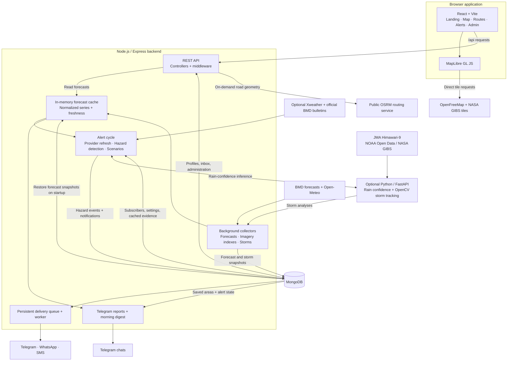
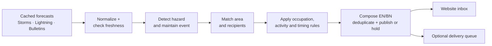

# AkashSathi (আকাশসাথী)

[](https://github.com/ayhanarashtasin/HackForHumanity_Hackathon/actions/workflows/ci.yml)


**Bangladesh-focused weather intelligence and occupation-aware alerts.**

AkashSathi, meaning "sky companion," helps people understand how local weather may affect their work and daily activities. Developed for HackForHumanity, it combines an interactive weather map, English and Bangla guidance, an anonymous alert inbox, and optional messaging integrations for farmers, fishermen, construction workers, vendors, students, and rickshaw pullers.

**8 divisions · 64 districts · 544 BMD forecast locations · বাংলা / English**

The same forecast can mean protecting a farmer's harvest, postponing exposed rooftop work, or allowing extra time for a school commute. AkashSathi separates weather-hazard detection from occupation-specific advice so each alert can explain **what is expected, where it applies, why it matters, and what to do next**.

> [!IMPORTANT]
> **This is a prototype, not an official warning service.** AkashSathi does not replace Bangladesh Meteorological Department (BMD) guidance. Alert thresholds have not been expert-validated. Missing, stale, or unavailable data must never be interpreted as safe conditions.

## Table of contents

- [Features](#features)
- [Architecture](#architecture)
- [Technology stack](#technology-stack)
- [Getting started](#getting-started)
- [Configuration](#configuration)
- [Using the application](#using-the-application)
- [ML and storm tracking](#ml-and-storm-tracking)
- [Messaging integrations](#messaging-integrations)
- [Data sources and coverage](#data-sources-and-coverage)
- [API overview](#api-overview)
- [Project structure](#project-structure)
- [Development commands](#development-commands)
- [Testing](#testing)
- [Deployment](#deployment)
- [Security and privacy](#security-and-privacy)
- [Known limitations](#known-limitations)
- [Troubleshooting](#troubleshooting)
- [Documentation](#documentation)
- [Contributing](#contributing)
- [License and attribution](#license-and-attribution)

## Features

| Capability | Description |
| --- | --- |
| Interactive weather map | Temperature, computed heat index, rainfall, wind, and thunderstorm potential, with selectable indicators, radar and satellite playback, location search, and fullscreen exploration. |
| Route-weather planning | A dedicated road-route map with an alternative when available, arrival-time forecasts, division/district/upazila summaries, nearby lightning checks, and a destination outlook. |
| Occupation-aware alerts | Scenario-based guidance using a subscriber's occupation, selected areas, activity, and work context. Cards include severity, evidence, source, validity, and recommended actions. |
| Anonymous profiles | Browser-based registration without an account, name, email address, or phone number. Profiles support editing, pausing, deletion, and temporary activity changes. |
| Optional external delivery | Telegram, WhatsApp, and SMS copies of inbox alerts, with verified connections, quiet hours, delivery limits, and retries. |
| Telegram weather reports | English and Bangla weather commands, including `/route start to destination`, interactive report buttons, and a scheduled morning forecast for connected profiles. |
| Administrator dashboard | Alert previews, manual declarations, messages, withdrawals, severity holds, hazard switches, delivery health, and isolated demo audiences. |
| Bilingual interface | Persistent বাংলা / English switching across public and admin screens, localized dates and numbers, and a self-hosted Bengali font with responsive text layouts. |
| Cached forecasts and history | Background collection, persisted snapshots, per-source freshness indicators, and compact district-level forecast history. |
| Experimental rain confidence | Two Random Forest classifiers add High / Medium / Low confidence labels to qualifying rain alerts without changing their severity or publication. |
| Experimental storm tracking | Himawari-9 cloud-cell detection, motion estimates, 30/60/90-minute projections, area-arrival estimates, and prototype storm-approach warnings. |

## Architecture

AkashSathi is an **npm-workspace monorepo with a React client, a modular Express backend, MongoDB persistence, and an optional Python inference service**. Background jobs run inside the Node.js server process; there is no separate message broker or standalone worker application.

The central design is **collect → normalize → cache/persist → evaluate → serve**. Opening a forecast page, polling an inbox, or requesting a Telegram weather report does not trigger upstream weather collection.

### System overview

GitHub renders the following Mermaid diagrams directly.



**Request-time exceptions:** road-route searches contact OSRM, and a Telegram `/route` place name that the bot's own lists do not know is looked up with OpenStreetMap Nominatim (`ROUTE_GEOCODER=off` disables it); radar images use an allowlisted, cached BMD proxy; storm replay and image endpoints can call the internal Python service. Satellite and basemap tiles load directly in the browser. These paths do not initiate new forecast or Xweather collection.

### Component responsibilities

| Component | Responsibility | Main entry points |
| --- | --- | --- |
| Browser client | Lazy-loaded screens, History API routing, English/Bangla UI, geolocation-to-area matching, map rendering, and API polling. | [`client/src/App.jsx`](client/src/App.jsx), [`client/src/pages/`](client/src/pages), [`client/src/map/WeatherMap.js`](client/src/map/WeatherMap.js) |
| HTTP boundary | Route dispatch, input handling, cookie-based sessions, origin protection for subscriber/admin routes, rate limits, and error responses. | [`server/src/app.js`](server/src/app.js), [`server/src/routes/`](server/src/routes), [`server/src/middleware/`](server/src/middleware) |
| Weather data layer | Provider adapters, time/unit normalization, computed heat index, district aggregation, fallback selection, and freshness metadata. | [`server/src/services/weatherStore.js`](server/src/services/weatherStore.js), [`bmdForecast.js`](server/src/services/bmdForecast.js), [`openMeteo.js`](server/src/services/openMeteo.js) |
| Alert engine | Refresh optional inputs, detect occupation-neutral hazards, select recipients, apply occupation/activity scenarios, compose bilingual cards, and manage event lifecycles. | [`server/src/services/alerts/`](server/src/services/alerts), [`server/src/config/alertRules.js`](server/src/config/alertRules.js) |
| Delivery and bot | Verified channel connections, queued alert copies, retry/backoff, quiet hours, delivery caps, Telegram reports, and daily forecasts. | [`server/src/services/delivery/`](server/src/services/delivery) |
| Python service | Random Forest rain-confidence inference and Himawari cloud-cell tracking; called by Node, not directly by the browser. | [`ml-service/app.py`](ml-service/app.py), [`ml-service/storm/`](ml-service/storm) |
| Scheduler | Start collectors and independent alert/delivery jobs after MongoDB connects; stop jobs during shutdown. | [`server/src/server.js`](server/src/server.js), [`server/src/jobs/scheduler.js`](server/src/jobs/scheduler.js) |

### Alert-processing pipeline



Hazards include heavy rain, heat stress, strong wind, dry spells, lightning, marine weather, official notices, satellite-derived storm approach, and observed river levels near or above FFWC danger levels. `HazardEvent` records the shared event; `Notification` records how it applies to a particular subscriber and scenario. Administrator declarations and free-text messages are explicitly distinguished from automatic detections.

Key guarantees:

- **Freshness before action:** stale data may annotate an existing alert, but cannot create or escalate one. Missing values are not converted into zero or a safe state.
- **Explainable notifications:** cards retain source references, evidence, affected area, validity, rule version, and recommended actions.
- **Database-backed deduplication:** unique indexes guard event keys, subscriber/event/scenario notifications, and notification/channel/stage deliveries.
- **Independent delivery:** the inbox is the primary record. External channels copy stored alerts and re-check eligibility before sending; provider delivery is not exactly-once.
- **Controlled administration:** automatic publication is the default; severity holds, per-hazard switches, confirmed sends, audit records, and isolated demo audiences are supported.

### Persistence model

| Model / group | Responsibility |
| --- | --- |
| `Subscriber` | Anonymous profile, occupation answers, saved areas, temporary activity/current area, preferences, consent, and verified channel state. |
| `ForecastSnapshot` | Latest normalized BMD/Open-Meteo payloads; restored into memory on startup when weather jobs are enabled. |
| `WeatherRun` | Compact district-level run history; TTL retention defaults to 60 days. |
| `WeatherSnapshot` | Cached provider/product queries for optional forecast, maritime, lightning, bulletin, FFWC gauge, and DDM shelter processing. |
| `StormSnapshot` | Satellite-cell analyses retained for 30 days for later evaluation. |
| `LightningCampaign`, `LightningSample` | Scheduled map-summary campaign, sampling status, and stored results. |
| `HazardEvent` → `Notification` → `Delivery` | Shared hazard lifecycle → personal inbox card → external-channel delivery attempts. |
| `MorningDigest` | Per-subscriber/day progress and outcomes, retained for 30 days without message text or chat IDs. |
| `AdminSession`, `AdminAction` | Administrator sessions, send idempotency, and audit history. |
| `EngineSettings`, `RuleSetting`, `JobState`, `Area` | Engine configuration, versioned rule metadata, task state/leases, and seeded area reference data. |

Schemas and indexes live in [`server/src/models/`](server/src/models). MongoDB is required even when external delivery and ML are disabled.

### Background schedules

The schedules below reflect the default configuration. Available tuning options are defined in [`server/src/config/env.js`](server/src/config/env.js).

| Task | Default cadence / behavior |
| --- | --- |
| BMD forecast | Probe every 30 minutes; fetch all locations only when the model run changes. |
| Open-Meteo forecast | Every 180 minutes, aggregated into three-hour windows. |
| Radar / satellite indexes | Every 10 / 30 minutes. |
| Storm analysis | Check every 2 minutes for newly published ten-minute satellite frames. |
| Alert engine | Every 2 minutes; optional Xweather forecast/maritime refreshes are due approximately every 3 / 6 hours. |
| FFWC river gauges | Checked within alert cycles, at most every 30 minutes; a failed refresh retries after 10 minutes. |
| DDM flood shelters | Cached for 24 hours and refreshed alongside a successful FFWC fetch. |
| Official bulletins | Checked within alert cycles, at most every 30 minutes after a completed check. |
| Lightning map campaign | 07:00, 15:00, and 23:00 Asia/Dhaka, with campaign and quota limits. |
| External alert delivery | Every 30 seconds. |
| Telegram morning digest | One-minute scheduler tick; default send time is 06:00 Asia/Dhaka. |

Alert and delivery jobs use database leases to coordinate workers. Forecast caches and HTTP rate limits are process-local, so horizontal scaling requires additional coordination; this is not a stateless, independently scaled worker architecture.

## Technology stack

| Layer | Technologies |
| --- | --- |
| Frontend | React 19, Vite 8, MapLibre GL JS 6, CSS |
| Backend | Node.js 22.12+, Express 5 |
| Database | MongoDB, Mongoose 9 |
| Optional inference service | Python 3.12+, FastAPI, Uvicorn, scikit-learn, pandas, NumPy, Joblib, OpenCV |
| Mapping and geography | MapLibre GL JS, GeoJSON, OpenFreeMap/OpenStreetMap, OSRM |
| Messaging | Telegram Bot API, WhatsApp Business Cloud API, Twilio or a configurable HTTP SMS gateway |
| Tooling | npm workspaces, Node.js test runner, concurrently |

The frontend uses plain CSS and a lightweight History API router rather than a routing framework. Map, route, alert, flood, and administrator pages are lazy-loaded. Visual tokens and weather-color conventions are documented in [`docs/design.md`](docs/design.md).

## Getting started

### Prerequisites

- **Node.js 22.12 or later**, with npm.
- **MongoDB**, either running locally or accessible through MongoDB Atlas.
- **Python 3.12+** (stable release), optional for rain-confidence labels and satellite storm tracking. MongoDB 8 is used in CI.
- Internet access for weather collection and map imagery. Provider credentials are optional for the core map and website inbox.

### 1. Install dependencies

Clone the repository if you do not already have a local checkout:

```sh
git clone https://github.com/ayhanarashtasin/HackForHumanity_Hackathon.git
cd HackForHumanity_Hackathon
```

From the repository root, install dependencies:

```sh
npm ci
```

This installs both workspaces using the committed lockfile. Use `npm install` when intentionally changing dependencies.

### 2. Configure the server

Copy [`server/.env.example`](server/.env.example) to `server/.env` using **one** of the following commands. Do not overwrite an existing environment file.

**macOS / Linux / Git Bash**

```sh
cp server/.env.example server/.env
```

**Windows PowerShell**

```powershell
Copy-Item server/.env.example server/.env
```

The example is configured for a local MongoDB instance:

```dotenv
MONGODB_URI=mongodb://127.0.0.1:27017/environmental_hackathon
PORT=5000
CLIENT_ORIGIN=http://localhost:5173
```

For Atlas, replace `MONGODB_URI` with your connection string, including a dedicated database name. Keep credentials in `server/.env`; never commit them.

### 3. Start development servers

```sh
npm run dev
```

| Service | Local address |
| --- | --- |
| Landing page | <http://localhost:5173> |
| Weather map | <http://localhost:5173/map> |
| Route-weather planner | <http://localhost:5173/route> |
| River levels and flood shelters | <http://localhost:5173/flood> |
| Alert registration and inbox | <http://localhost:5173/alert> |
| Administrator dashboard | <http://localhost:5173/admin> — requires administrator setup |
| API health and source freshness | <http://localhost:5000/api/health> |
| Optional Python service health | <http://127.0.0.1:8001/health> |

Vite proxies `/api` requests to the backend. Collection starts after the API connects to MongoDB; the first forecast may take time to arrive. Existing forecast snapshots are restored when weather jobs are enabled.

**Quota-safe development:** leave Xweather credentials unconfigured, or set both `LIGHTNING_ENABLED=off` and `ALERT_XWEATHER=off`. Adding valid credentials with the default switches enabled allows background jobs to spend the provider allowance.

**FloodSense configuration:** river gauges stay off until a valid `FFWC_API_KEY` is set. The FFWC gateway also checks the `FFWC_ORIGIN`/referer values, which default to `https://ffwc.gov.bd`. Without a key, `/flood` shows an unavailable state; `/flood/demo` still works. DDM shelter matching is independent and can be disabled with `DDM_SHELTERS=off`.

Generated boundaries and location catalogues are already committed. Geography builds are not required for normal setup.

### 4. Optional Python service

`npm run dev` also attempts to start the Python service. The first run creates `ml-service/.venv` and installs the pinned packages in `requirements.txt`; the trained models are committed. If Python is missing or startup fails, the frontend and backend continue running without rain-confidence labels or new storm analyses.

To run just the Python service:

```sh
npm run ml
```

The server uses `ML_SERVICE_URL` to reach it. Development defaults to `http://127.0.0.1:8001`; an explicitly empty value disables integration. In production, set the URL explicitly. See [ML and storm tracking](#ml-and-storm-tracking) for behavior and limitations.

## Configuration

Server configuration is loaded from `server/.env`. The complete template is [`server/.env.example`](server/.env.example); validation and additional tuning options are defined in [`server/src/config/env.js`](server/src/config/env.js). Restart the backend after changing environment variables.

| Variable | Default | Purpose |
| --- | --- | --- |
| `NODE_ENV` | `development` | Runtime environment; use `production` on a deployed server. |
| `PORT` | `5000` | API listening port. |
| `MONGODB_URI` | Local MongoDB URI | Database connection string. |
| `CLIENT_ORIGIN` | `http://localhost:5173` | Frontend origin allowed by CORS and the origin guard. |
| `PUBLIC_URL` | `http://localhost:5173` in the example | Website address used in external message links. |
| `TRUST_PROXY` | `0` | Number of trusted reverse-proxy hops; match the deployment topology. |
| `WEATHER_JOBS` | `on` | BMD, Open-Meteo, radar, satellite, and storm collectors. Does not disable the alert engine, lightning campaign, or delivery. |
| `WEATHER_HISTORY_DAYS` | `60` | District-summary retention; `0` disables recording new history. |
| `ML_SERVICE_URL` | Local service in development; unset/off in production | Internal Python-service URL for rain-confidence inference and storm tracking; an empty value disables both. The supplied example explicitly sets the local URL. |
| `ML_TIMEOUT_MS` | `3000` | Rain-confidence request timeout; alerts continue without a confidence label on failure. |
| `STORM_MINUTES` | `2` | Interval for checking newly published satellite frames through the Python service. |
| `LIGHTNING_ENABLED` | `on` | Scheduled Xweather map-summary campaign, when credentials are present. |
| `ALERT_ENGINE` | `on` | Automatic hazard detection and notification publication. |
| `ALERT_TICK_MINUTES` | `2` | Alert-engine cycle interval. |
| `ALERT_XWEATHER` | `on` | Alert-engine Xweather requests, when credentials are present. |
| `ALERT_BULLETINS` | `on` | Official BMD bulletin checks within the alert engine. |
| `ALERT_BMD_RAIN_VERIFIED` | `off` | Enables BMD rainfall amounts for thresholds only after their units have been verified. |
| `FFWC_ENABLED` | `on` | Enables FFWC river-gauge collection; requires `FFWC_API_KEY`. |
| `FFWC_API_KEY` | Unconfigured placeholder | FFWC gateway key issued for this project; kept server-side. Without it, flood collection stays quiet. |
| `FFWC_API_URL` | `https://api.ffwc.gov.bd` | FFWC API base URL. |
| `FFWC_ORIGIN` | `https://ffwc.gov.bd` | Origin/Referer the FFWC gateway expects; the API uses it for both headers. |
| `FFWC_REFRESH_MINUTES` | `30` | Gauge refresh interval when the alert engine runs; failed refreshes retry after 10 minutes. |
| `FFWC_MAX_AGE_MINUTES` | `180` | A reading older than this cannot create or escalate a flood alert. |
| `FFWC_TIMEOUT_MS` | `15000` | Timeout for each FFWC request. |
| `DDM_SHELTERS` | `on` | Enables the DDM flood-shelter list and nearest-shelter matching. |
| `DDM_SHELTER_URL` | `https://rapid.ddm.gov.bd/service/shelter_info` | Public DDM shelter page parsed for Flood shelters. |
| `DDM_SHELTER_REFRESH_HOURS` | `24` | Shelter-list refresh interval; the previous list remains usable and is labelled stale if DDM fails. |
| `FLOOD_MAX_SHELTERS` | `3` | Maximum shelters offered per alert area (1–5). |
| `ADMIN_PASSCODE` | Unconfigured placeholder | Enables administrator login with a non-placeholder passcode of at least 8 characters. |
| `ADMIN_AUTH` | `on` | Set `off` only for local loopback demos; the bypass is ignored in production. |
| `DELIVERY` | `on` | External delivery, the Telegram bot, and its morning-digest job. Unconfigured channels remain idle. |
| `CHANNEL_SECRET` | Unconfigured placeholder | Phone-number encryption secret for WhatsApp and SMS; at least 16 random characters. |
| `MORNING_DIGEST` | `on` | Scheduled Telegram morning weather message. |
| `MORNING_DIGEST_TIME` | `06:00` | Digest send time in `Asia/Dhaka`, using 24-hour `HH:mm` format. |
| `MORNING_DIGEST_GRACE_HOURS` | `4` | Catch-up window after the scheduled time. |
| `DNS_SERVERS` | Unset | Optional comma-separated DNS servers for Atlas SRV-resolution problems. |

To run without background provider collection or messaging, set:

```dotenv
WEATHER_JOBS=off
LIGHTNING_ENABLED=off
ALERT_ENGINE=off
DELIVERY=off
```

This is useful for isolated API work, not an offline weather mode: map tiles still need connectivity, and forecast snapshots are not restored into memory when `WEATHER_JOBS=off`.

**Client configuration:** the default API base is `/api`. If needed, copy [`client/.env.example`](client/.env.example) to `client/.env` and set `VITE_API_URL` or the development/preview `API_PROXY_TARGET`. `VITE_` variables are browser-visible; never put secrets there.

**Python launcher configuration:** `ML_PORT` changes the service port and `STORM_SOURCE` selects `noaa` (default) or `gibs`. Set these in the shell/process environment before starting the launcher; it does not load `server/.env`. If the port changes, update the backend's `ML_SERVICE_URL` separately.

## Using the application

### Pages

| Route | Purpose |
| --- | --- |
| `/` | Project introduction, division atlas, coverage information, occupation guidance, and attribution. |
| `/map` | Weather layers, radar and satellite playback, forecast timeline, bilingual place search, and shareable map views. |
| `/route` | Road-route search, an alternative when available, interactive route map, arrival-time weather, regional summaries, and destination outlook. |
| `/flood` | FFWC river levels matched to upazilas, nearest DDM flood shelters, thresholds, and a clearly labelled demo view. |
| `/alert` | Bilingual registration, inbox, profile controls, channel connections, source coverage, and official-document references. |
| `/admin`, `/admin/login` | Protected administration and demo tools; not linked from public navigation. |

### Occupation-aware alerts

1. Open `/alert` and select an occupation, home/work areas, relevant activity, and language.
2. Receive scenario-based notifications in the website inbox. Each card explains the hazard, why it applies, its validity, and the supporting data.
3. Optionally connect a messaging channel under **Alerts on your phone**.
4. Edit, pause, or delete the profile, or temporarily update the current activity.

An HttpOnly cookie identifies the browser; the server stores only its token hash. Profiles are not portable between devices, and clearing site data removes access to the existing profile.

The engine evaluates monitored areas every two minutes by default. Weather scenarios use cached forecasts; optional Xweather data adds hourly, maritime, WBGT, and lightning coverage. Verified, dated North Bay marine notices can generate fisherman alerts. Other bulletin products remain reference links when scope, timing, or document structure cannot be verified.

Automatic publication is the default. Administrators can hold selected severities as drafts or disable individual hazard types. Stale data may annotate an existing alert but must not create, escalate, or rewrite it. Lightning alerts are always `CRITICAL`; expiry and withdrawal do not imply an all-clear.

### River levels and flood shelters

`/flood` is a read-only observation view built from the same cached snapshots as the alert engine. It never calls FFWC or DDM during a page load.

- **Gauge matching:** each FFWC observed gauge is matched to its upazila (or, as a fallback, its district) using the name, not a guessed coordinate. Unmatched gauges are counted and listed rather than silently dropped.
- **Classification:** `APPROACHING` means the measured level is within **0.5 m below** FFWC's published danger level; `ABOVE` is at or above it; `SIGNIFICANTLY_ABOVE` is at least **1.0 m above**. The half-metre approach band is a project rule because FFWC does not publish an “approaching” class. Zero or missing danger levels are treated as unavailable, not as normal.
- **One card per area:** several gauges in one upazila become one group led by the highest level; a district fallback card is dropped when upazila cards exist. The page shows only areas with `level > 0`. An empty list explicitly says it is **not an all-clear**.
- **Alerts:** a qualifying area creates a `RIVER_FLOOD` event evaluated by scenario `FLOOD-01`. Level 1 is `ADVISORY`; levels 2–3 are `WARNING`. The card reports FFWC's measurement and danger level and never claims that flooding has occurred or that a place is safe. Withdrawal means the gauge returned below the approach band, not that conditions are safe.
- **Staleness:** a reading older than `FFWC_MAX_AGE_MINUTES` (default 180) can annotate an existing event but cannot create or escalate one. Only a fresh/partial snapshot with a fresh per-gauge reading can withdraw an event.
- **Shelters:** DDM's public list is limited to `Flood` shelters with usable coordinates; the nearest three within 50 km are shown with roughly measured distance, capacity, and accessibility flags. DDM does not publish live occupancy or open/closed status, so the page tells people to check before travelling. If DDM is down, the previous list is shown and labelled stale.
- **Demo:** `/flood/demo` and the page's demo toggle are illustrative only. They write no events, create no notifications, and send nothing.

### Administrator setup and demo

Set a strong `ADMIN_PASSCODE` in `server/.env`, restart the backend, and open `/admin`. `ADMIN_AUTH=off` is a local-only demonstration bypass and produces a startup warning.

For a demonstration, use **Settings** to create a demo audience in a selected upazila, preview a weather alert or manual declaration, confirm the send, and inspect its read-only **View as** inbox. Use **History → Withdraw** to demonstrate withdrawal. Demo notifications are isolated from live subscribers and external delivery. Unsupported declarations and `CRITICAL` sends require additional confirmation; confirmed sends and withdrawals are audited.

### Weather map

- **Shared location:** on the map, route, and alert pages, a dismissible notice explains location use before the browser permission prompt. Choose **Use my location** to detect an area once and reuse it across these screens in this tab. Declining never blocks manual area selection. For an alert profile, only the temporary upazila code is sent; it expires after 15 minutes without updates and never replaces saved home/work areas or active Telegram following. Continuous browser following remains a separate opt-in on the alerts page.
- **Weather layers:** temperature, heat index, rain, wind, and thunderstorm potential. District summaries appear at lower zoom levels; detailed locations appear as you zoom in.
- **Radar:** Dhaka and Rangpur BMD radar, with 10-minute frames covering the last three hours.
- **Satellite:** Himawari-9 infrared and visible imagery via NASA GIBS; imagery is delayed, not instantaneous.
- **Timeline:** switch between imagery playback and three-hourly forecasts for approximately four days.
- **Route weather:** open `/route` and choose a start and destination, or explicitly use your location as the start. The server selects the shortest-distance route among the OSRM options returned, with one alternative when available; this is not a guarantee of the shortest possible road and is not weather-optimized. The page draws the road, estimates arrival-time weather, groups stops by division/district/upazila, and shows a three-day destination outlook when available. OSRM receives the selected coordinates, including precise device coordinates if you use your current location as the start.
- **Telegram route report:** send `/route Dhaka Bandarban` (`to` and `থেকে` are optional), `/route here Sylhet` to start from a one-time location share, or `/route Bandarban` and answer "Where do you start?". Places can be divisions, districts (routed to the district town, such as Motijheel for Dhaka), upazilas, thanas, city corporations, unions, paurashavas, city wards, the route page's neighbourhoods, and common old spellings (Chittagong, Comilla, Jessore). Unknown names go to OpenStreetMap Nominatim, then to "did you mean" suggestions; ambiguous names get buttons. The reply lists the worst weather on the way and when, each district (or upazila on short trips) at the time you pass it, the destination after arrival, recent lightning checks, satellite storm cells meeting the road, active alerts on the road, and the other road when OSRM has one. Buttons plan the way back, a departure in three hours, or tomorrow at 07:00. Unions, neighbourhoods and map points use their upazila's forecast; a missing forecast is shown as ⚪, never as calm.
- **Search and sharing:** search in English or Bangla; the URL hash preserves the map view and selected layers. Legacy `/#view=...` links redirect to `/map`.
- **Language:** search, controls, tooltips, and area details support Bangla. Map canvas labels remain English because the hosted glyphs and WebGL text shaping do not support Bengali reliably. Delivered messages and official quotations retain their original language; Bengali copy still needs fluent-human review.
- **Data interpretation:** grey means no data. Forecasts are not station observations, thunderstorm potential is not a detected strike, and computed heat index is not an on-site WBGT measurement.
- **Route provider:** road geometry comes from the public OSRM routing service. It can be unavailable and has no project-controlled uptime; route distances, ETAs, and sampled weather are estimates.

## ML and storm tracking

The optional FastAPI service has two distinct responsibilities. It does not replace the rule-based alert engine.

### Rain forecast confidence

Two Random Forest classifiers assess qualifying **Open-Meteo-based rain alerts**:

| Target | Applied to | Output |
| --- | --- | --- |
| `moderate` | Level 1 rain detections | High / Medium / Low confidence band. |
| `heavy` | Level 2 and 3 rain detections | High / Medium / Low confidence band. |

The Node engine batches eligible detections into `POST /predict` and adds one explanatory line, such as **“Forecast confidence: High.”** The result never creates, cancels, raises, or lowers an alert. A timeout or unavailable service leaves the underlying alert unchanged.

Training uses historical Open-Meteo forecasts and ERA5 reanalysis rainfall, not ground-station measurements. The application displays bands, not percentage guarantees; the heavy-rain model's probability calibration is not validated. Model construction and evaluation are documented in [`ml-service/README.md`](ml-service/README.md), [`evaluation.md`](ml-service/reports/evaluation.md), and [`evaluation_moderate.md`](ml-service/reports/evaluation_moderate.md).

### Satellite storm movement

1. Read Himawari-9 band 13 data from NOAA Open Data by default, or NASA GIBS imagery with `STORM_SOURCE=gibs`.
2. Identify sufficiently large, cold cloud-top cells and estimate motion using OpenCV Farneback optical flow.
3. Apply an assumed cloud-height parallax correction, then project cells 30, 60, and 90 minutes forward.
4. Return motion, intensity, temperature where available, and potentially affected areas; retain analyses in MongoDB.
5. Let the Node alert engine evaluate `STORM_APPROACH` / `PUBLIC-06` for qualifying cells approaching subscribers' areas within 60 minutes from now.

NOAA frames typically arrive about 15 minutes after the scan; GIBS images typically arrive 45–60 minutes later. Storm warnings default to **Telegram only**, bypass quiet hours, and still respect the daily cap. Old imagery cannot create or advance a warning. Satellite cloud intensity is **not observed lightning**, and straight-line tracking does not predict storms forming overhead.

For a local demonstration without waiting for a live storm, start the Python service and open:

<http://localhost:5173/map#o=storms&storm=replay>

This replays saved imagery from **22 September 2026**, not current conditions. The recorded NOAA tracking evaluation reports a **28.4 km median position error at 60 minutes on one saved day**; it is an experimental result, not an operational accuracy guarantee. See [`storm_validation_noaa.json`](ml-service/reports/storm_validation_noaa.json) and the [implementation status](docs/IMPLEMENTATION_STATUS.md).

## Messaging integrations

The website inbox is the primary alert record. Optional channels send short copies of stored notifications; they do not evaluate weather independently. Set `DELIVERY=off` to disable the entire messaging layer.

| Channel | Connection | Default severity | Daily cap per subscriber |
| --- | --- | --- | --- |
| Telegram | One-time bot link; no phone number required | `ADVISORY` and above | 20 |
| WhatsApp | Consented Bangladeshi mobile number, verified by code | `WARNING` and above | 6 |
| SMS | Consented Bangladeshi mobile number, verified by code | `WARNING` and above | 6 |

Routine messages respect quiet hours and caps; **`CRITICAL` alerts bypass both**. Satellite storm-approach warnings also bypass quiet hours, but not the daily cap, and default to Telegram only. Draft, demo, withdrawn, expired, stale-data, and superseded stages are excluded. By default, updates older than three hours are not delivered externally. Temporary failures retry with backoff, and blocked destinations are disconnected.

Unique delivery keys and worker leases prevent routine duplicate processing. They do **not** guarantee exactly-once provider delivery: a crash after a provider accepts a message but before the database records success can result in a duplicate.

### Telegram setup

1. Create a bot through [@BotFather](https://t.me/BotFather) using `/newbot`.
2. Set `TELEGRAM_BOT_TOKEN` and `PUBLIC_URL` in `server/.env`, then restart the backend.
3. Open `/alert` → **Alerts on your phone** → **Connect Telegram** → **Open Telegram** → **Start**.

Without `TELEGRAM_WEBHOOK_URL`, the backend uses polling, which works locally. For a webhook deployment, configure:

```dotenv
TELEGRAM_WEBHOOK_URL=https://your-domain.example/api/channels/telegram/webhook
TELEGRAM_WEBHOOK_SECRET=replace_with_a_random_webhook_secret
```

The webhook requires public HTTPS and a secret containing 16–256 characters from `A–Z`, `a–z`, `0–9`, `_`, or `-`. The backend registers it at startup and verifies Telegram's secret header. The bot handles private chats only; `/help` explains usage and `/stop` disconnects the chat.

### Telegram weather commands

Weather commands are available with or without a connected profile and read stored forecasts only.

| Command | Report |
| --- | --- |
| `/update [place]` | Current three-hour forecast step, next 12 hours, latest lightning check, stale-data warnings when applicable, and report buttons. Without a place it prefers the recently shared area, then saved areas; it offers a one-time location-share button when using saved areas. |
| `/follow` | In a linked private chat, ask for a live location share within five minutes to follow movement for alerts. |
| `/unfollow` | Stop Telegram location following without disconnecting saved-area alerts. |
| `/heat [place]` | Temperature, heat index, next-24-hour peak, category, and practical guidance. |
| `/rain [place]` | Next-24-hour total and wettest interval, plus a three-hourly timeline for the next 12 hours with rainfall probability. |
| `/wind [place]` | Wind, gusts, and the strongest forecast gust in the next 24 hours. |
| `/thunderstorm [place]` | Forecast thunderstorm potential and any modeled thunderstorm or hail conditions. |
| `/lightning [place]` | Latest stored lightning checks and their age, not continuous strike monitoring. |
| `/forecast [place]` | Multi-day temperature, rainfall, wind, and thunderstorm outlook. |
| `/route start destination` | A road trip with its weather: the worst hazards and when, stops at passing time, destination outlook, lightning, storm cells and active alerts on the road, and buttons for the way back or a later departure. `to`/`থেকে` are optional; `/route here <place>` starts from a shared location. Aliases: `/trip`, `/travel`. |
| `/alerts` | Active inbox alerts for the connected profile. |
| `/status` | Source freshness and the alert engine's latest run. |

Examples: `/heat Badda`, `/rain বাড্ডা`, `/wind Savar, Dhaka`, or `/forecast Badda bn`. Places may be upazilas, city thanas, districts, or city corporations; ambiguous names return candidates. A connected chat without a typed place uses a fresh current area, otherwise up to two saved areas. A one-time Telegram location share answers a weather report only; it does not turn on tracking. `/follow` requires explicitly sharing **Live Location** through Telegram's location attachment; edited live updates refresh a short-lived area code (15-minute expiry) for relevant personal alerts, never raw coordinates. Stop Telegram sharing or send `/unfollow` to end it. The bot cannot read GPS merely because `/update` was sent, and its checks still use cached forecasts. Aliases include `/weather`, `/thunder`, `/storm`, and `/days`.

A trailing `bn` or `en` selects the language; otherwise the bot uses profile, place-script, or Telegram language preferences. Compact report headings identify forecasts, stale data carries an update-time warning, and `/status` lists source freshness and age. Missing values are never presented as zero, and "no active alert" is not an all-clear. Rain amounts prefer current Open-Meteo data because BMD rainfall units remain unconfirmed. The default request limit is 30 commands per chat per 10 minutes (`TELEGRAM_COMMAND_LIMIT`).

### Morning weather message

By default, active, non-demo profiles with connected Telegram chats receive a daily forecast at **06:00 Asia/Dhaka**, with one message for each saved area, up to two areas. Each report includes temperature range, heat guidance, rain, wind, thunderstorm potential, the latest lightning check, active-alert count, day-part forecasts, a brief tomorrow outlook, and report buttons.

- `MORNING_DIGEST=off` disables the feature globally; `MORNING_DIGEST_TIME` changes the scheduled time.
- `MORNING_DIGEST_GRACE_HOURS` defaults to four hours. Catch-up and retries stay within that day's send window, which is at least 10 minutes and never extends past midnight.
- Missing or stale forecasts are deferred; uncovered places are skipped. Keep `WEATHER_JOBS=on` to populate the forecast cache.
- Quiet hours are respected. A database progress record coordinates ticks, restarts, and workers; completed area messages are not repeated during ordinary retries.
- Digests run outside the alert delivery queue, do not consume the Telegram alert cap, and are not included in administrator delivery counts.
- **There is no separate per-profile digest opt-in, time setting, or opt-out yet.** `/stop` disconnects Telegram for both digests and alerts.

### WhatsApp templates

Set `WHATSAPP_ACCESS_TOKEN`, `WHATSAPP_PHONE_NUMBER_ID`, and `CHANNEL_SECRET`. Business-initiated messages require approved Meta templates:

1. **Alert template:** `WHATSAPP_ALERT_TEMPLATE` defaults to `akashsathi_alert`. Submit a Utility template in each enabled language (`WHATSAPP_TEMPLATE_LANG_EN` / `WHATSAPP_TEMPLATE_LANG_BN`) with exactly four body variables:

   ```text
   AkashSathi {{1}}: {{2}}

   {{3}}

   Valid until {{4}}. More details on the AkashSathi alerts page.
   ```

   Variables represent severity, title, message with sender attribution, and validity end time, respectively.

2. **Verification template:** set `WHATSAPP_OTP_TEMPLATE` to an approved Authentication template with a copy-code button. The verification code is passed as both the body variable and button parameter. Without it, WhatsApp remains unavailable.

### SMS gateways

Set `CHANNEL_SECRET` and choose `SMS_PROVIDER=twilio` or `SMS_PROVIDER=http`.

- **Twilio:** configure `TWILIO_ACCOUNT_SID`, `TWILIO_AUTH_TOKEN`, and either `TWILIO_FROM` or `TWILIO_MESSAGING_SERVICE_SID`.
- **HTTP gateway:** configure `SMS_HTTP_URL`, `SMS_HTTP_METHOD`, and, for POST requests, `SMS_HTTP_CONTENT_TYPE` and `SMS_HTTP_BODY`. Optional headers use `SMS_HTTP_HEADERS`.
- Supported placeholders are `{to}` (`+8801712345678`), `{to_digits}` (`8801712345678`), `{to_local}` (`01712345678`), and `{text}`. JSON substitution escapes message values.
- Set `SMS_HTTP_SUCCESS_MATCH` when the gateway can return HTTP 200 for a rejected message. Examples are included in [`server/.env.example`](server/.env.example).

Use an appropriately registered sender ID. English SMS content is ASCII and limited to 320 characters; Bangla content is limited to 200 characters. WhatsApp and SMS may incur provider charges; confirm pricing before enabling them.

**Verification status:** automated delivery tests use mocked providers. The repository does not document successful validation against live Telegram, WhatsApp, or SMS accounts. Confirm credentials, templates, gateway response handling, and end-to-end delivery before public use.

## Data sources and coverage

| Source | Use | Important considerations |
| --- | --- | --- |
| BMD WRF forecast via `api.bdservers.site` | Temperature, rain, humidity, wind, gusts, cloud, three-hourly forecasts, and a 10-day outlook | Third-party host; no published uptime guarantee or confirmed usage terms. Rainfall units are not independently verified. |
| BMD radar (`radar.bmd.gov.bd`) | Radar frames and geographic bounds | Allowlisted server proxy for image access. |
| BMD bulletins (`bmd.gov.bd`) | Official marine, fishermen, and fleet documents | Only sufficiently verified, dated North Bay statements drive automatic marine notices. |
| Open-Meteo | Forecast fallback, rainfall, precipitation probability, and thunderstorm potential | Review attribution and free-tier/non-commercial usage terms. |
| NASA GIBS / JMA Himawari-9 | Infrared and visible satellite imagery | Browser-loaded tiles; delayed availability. |
| NOAA Open Data / JMA Himawari-9 | Raw band 13 data for storm tracking | ML service downloads two of ten full-disk segments (about 5.5 MB) per 10-minute frame; attribution requested, no endorsement. |
| Xweather | Hourly forecasts, maritime conditions, WBGT, and lightning products | Optional server-side credentials; quota-controlled background requests. |
| FFWC (`api.ffwc.gov.bd`) | Observed river levels, danger levels, station registry, and observed rainfall | Requires a project key plus the FFWC site's Origin/Referer headers. Observed data, not a forecast. Danger levels remain FFWC's; the “approaching” band is a project rule. |
| DDM shelter list (`rapid.ddm.gov.bd`) | Flood-shelter locations and facility flags | Public page parsed as HTML. Occupancy and open/closed status are not published; list can be stale. |
| OCHA/HDX COD-AB | Administrative boundaries | 495 upazila polygons, 12 city corporations, 64 districts, and 8 divisions in generated data; CC BY-IGO attribution. |
| OpenFreeMap / OpenStreetMap | Basemap | Preserve map attribution and applicable usage terms. |
| OSRM public routing service | Road geometry, route candidates, estimated distance, and travel time | On-demand requests disclose selected coordinates; availability and route quality are outside the project's control. Queued to about one request per second; a road search is reused for 30 minutes. |
| OpenStreetMap Nominatim | Telegram `/route` names that are not in the bot's own place lists | Only the typed name is sent, at most one request per second, cached for a day, limited to Bangladesh; ODbL attribution in the reply; `ROUTE_GEOCODER=off` disables it. |

District forecasts are derived from upazila values, not separately published BMD district forecasts. Some city thanas use markers rather than their own polygons; some newer administrative areas use a nearby forecast location. The map flags these approximations, but equivalent alert coverage labeling remains a known gap. Map-rendered place labels are English; search, tooltips, and panels support Bangla.

### Lightning campaign

The map campaign uses Xweather's `lightning/summary/closest` endpoint for aggregate search-circle counts, not individual strike coordinates. Configure `XWEATHER_CLIENT_ID` and `XWEATHER_CLIENT_SECRET` to enable it.

- Default duration: **10 days**, with at most **30 slots**, scheduled at **07:00, 15:00, and 23:00 Asia/Dhaka**.
- **Mode A:** 20 km searches per upazila, chosen only when the campaign fits the available budget after the reserve.
- **Mode B:** 14 circles of 100 km covering Bangladesh, used when per-upazila sampling does not fit. With the example allowance of 14,817 tokens, a reserve of 100, and assumed cost of one token per request, this is the selected mode.
- The selected mode is locked for the campaign. Database keys and leases coordinate workers; request cost is settled using provider headers, and authentication failures stop collection.

Each sample covers a five-minute interval. It is **not** continuous monitoring or a daily total; circle counts are not upazila counts, and overlapping circles are never summed. The alert engine's gated lightning probes are separate from this map campaign. Populated live lightning payloads remain unverified.

## API overview

The local API base is `http://localhost:5000/api`. Most JSON endpoints return `{ "data": ... }`; application errors include a `message` field and may include validation details. `/health` returns top-level health fields, and imagery endpoints return image data.

| Method | Endpoint | Purpose / access |
| --- | --- | --- |
| `GET` | `/api/health` | Database health and source freshness; `200` when connected, `503` otherwise. A healthy database does not imply fresh weather data. |
| `GET` | `/api/weather/snapshot`, `/api/weather/daily` | Cached forecasts and BMD daily outlook. |
| `GET` | `/api/weather/history?district=3026&source=bmd&days=7` | District run summaries; sources: `bmd`, `openMeteo`; lookback: 1–60 days. |
| `POST` | `/api/weather/route` | Road-route geometry, an alternative when available, and cached weather at sampled arrival times. |
| `GET` | `/api/radar/frames`, `/api/radar/image/:site/:file` | Radar frame index and proxied images. |
| `GET` | `/api/satellite/frames` | Available satellite times and tile URL template. |
| `GET` | `/api/lightning/status`, `/api/lightning/summaries`, `/api/lightning/upazila/:pcode` | Map-campaign status and results. |
| `GET` | `/api/storms`, `/api/storms/image/:name` | Latest live storm analysis, area-arrival estimates, and the analysed frame image. |
| `GET` | `/api/storms/demo`, `/api/storms/demo/image/:name` | Historical storm replay and saved frame images; requires the Python service. |
| `GET` | `/api/flood/status`, `/api/flood/stations` | Cached FFWC river groups and station readings; optional `district`/`upazila` filters on `/stations`. |
| `GET` | `/api/flood/shelters?lat=...&lon=...` | Nearest DDM shelters to a point or a known `upazila` pcode. |
| `GET` | `/api/flood/demo` | Illustrative flood preview; creates no events and sends nothing. |
| `GET` | `/api/alerts/schema`, `/api/alerts/status` | Registration schema and monitoring status. |
| `POST` | `/api/alerts/subscribe` | Create an anonymous browser profile. |
| `GET` | `/api/alerts/session` | Current session, including `profile: null` for a new visitor. |
| `GET`, `PUT`, `DELETE` | `/api/alerts/me` | Read, edit, or delete the current profile; subscriber cookie required. |
| `PUT` | `/api/alerts/me/activity`, `/api/alerts/me/status` | Temporary activity and pause/resume controls; subscriber cookie required. |
| `PUT` | `/api/alerts/me/current-area` | Set or clear a short-lived current area without replacing saved areas; subscriber cookie required. |
| `GET` | `/api/alerts/me/coverage`, `/api/alerts/inbox` | Personal coverage and inbox; subscriber cookie required. |
| `POST` | `/api/alerts/inbox/:id/read`, `/api/alerts/inbox/read-all` | Mark notifications read; subscriber cookie required. |
| `GET` | `/api/alerts/me/channels` | Channel availability and masked connection state; subscriber cookie required. |
| `POST` | `/api/alerts/me/channels/telegram/link` | Create a one-time Telegram connection link; subscriber cookie required. |
| `POST` | `/api/alerts/me/channels/:channel/start`, `/api/alerts/me/channels/:channel/verify` | Phone verification for `whatsapp` or `sms`; subscriber cookie required. |
| `DELETE` | `/api/alerts/me/channels/:channel` | Disconnect a channel; subscriber cookie required. |
| `POST` | `/api/channels/telegram/webhook` | Receive Telegram updates; configured secret header required. |
| `GET` | `/api/admin/session` | Administrator session state: `closed`, `signed-out`, or `signed-in`. |
| Various | `/api/admin/*` | Login plus protected overview, previews, sends, withdrawals, rules, settings, and demo tools. |

For example, the route endpoint accepts:

```json
{
  "start": { "name": "Savar", "lat": 23.8583, "lon": 90.2667 },
  "end": { "name": "Chattogram", "lat": 22.3569, "lon": 91.7832 }
}
```

Send JSON bodies with `Content-Type: application/json`. Subscriber and administrator endpoints use cookies; state-changing requests under those route groups are origin-checked. The Telegram webhook uses its own configured secret header instead.

The Python service is an internal API, with `GET /health`, `POST /predict`, and `/storms/*` endpoints. It should not be exposed publicly without additional access controls. See [`server/src/routes/`](server/src/routes), [`server/src/controllers/`](server/src/controllers), and [`ml-service/app.py`](ml-service/app.py) for the implemented contracts.

## Project structure

```text
.
├── client/
│   ├── public/
│   │   ├── data/             Committed GeoJSON boundaries and location catalogue
│   │   └── fonts/            Self-hosted Bengali font and its license
│   ├── src/
│   │   ├── pages/            Landing, map, route, flood, alert, and administrator pages
│   │   ├── map/              MapLibre layers, imagery, and interactions
│   │   ├── alert/            Registration, inbox, profiles, and channels
│   │   ├── admin/            Administrator dashboard views
│   │   ├── components/       Shared UI components
│   │   ├── hooks/            Polling and shared location subscriptions
│   │   ├── i18n/             English/Bangla translations and formatting
│   │   ├── lib/              Routing, scales, time, and UI utilities
│   │   └── services/         API clients
│   └── test/                 Client tests
├── server/
│   ├── data/                 Generated locations and lightning coverage
│   ├── src/
│   │   ├── config/           Environment, database, and alert rules
│   │   ├── controllers/      HTTP request handlers
│   │   ├── routes/           API route definitions
│   │   ├── middleware/       Authentication, origin checks, and limits
│   │   ├── models/           Mongoose schemas and indexes
│   │   ├── jobs/             Weather, storm, lightning, alert, delivery, digest jobs
│   │   └── services/
│   │       ├── alerts/       Hazards, scenarios, notifications, and admin
│   │       ├── delivery/     Queue, linking, adapters, bot reports, digest
│   │       └── *.js          Provider adapters, caching, geography, route weather
│   ├── test/                 Unit and MongoDB-backed integration tests
│   └── .env.example          Server configuration template
├── ml-service/
│   ├── app.py                Internal FastAPI inference and storm endpoints
│   ├── requirements.txt      Pinned Python dependencies
│   ├── models/               Committed trained Random Forest model bundles
│   ├── scripts/              Historical-data, dataset, and training utilities
│   ├── storm/                Imagery decoding, optical flow, tracking, validation
│   │   └── data/             Saved satellite frames for the historical replay
│   ├── reports/              Rain-model evaluation and storm-validation reports
│   └── tests/                Python storm/imagery tests
├── scripts/
│   └── ml-service.mjs        Cross-platform Python environment and service launcher
├── docs/                     Design, plans, provider notes, and project status
├── .github/workflows/ci.yml   Node tests, MongoDB integration tests, frontend build
├── package.json              Workspace scripts
└── package-lock.json         Reproducible dependency lockfile
```

## Development commands

Run these commands from the repository root.

| Command | Purpose |
| --- | --- |
| `npm run dev` | Start the backend watcher, frontend development server, and optional rain-confidence/storm-tracking service together (Python 3.12+ for the latter). |
| `npm run dev:server` | Start only the backend watcher. |
| `npm run dev:client` | Start only the frontend development server. |
| `npm run ml` | Start the rain-confidence and storm-tracking service on port 8001; sets up `ml-service/.venv` on first run. |
| `npm run build` | Build the frontend into `client/dist`. |
| `npm run preview` | Preview the frontend build on port 4173 with an `/api` proxy; start the backend separately. |
| `npm start` | Start the API without a watcher; does not serve the frontend. |
| `npm test` | Run client and server tests; database cases require `TEST_MONGODB_URI`. |
| `npm run test --workspace client` | Run frontend logic tests and any explicitly enabled browser checks. |
| `npm run test --workspace server` | Run the backend suite; set `TEST_MONGODB_URI` to include MongoDB-backed cases. |

### Committed geography

Generated geography and the landing-page outline are already committed. Normal development does not need to regenerate them. Review intentional data changes in `client/public/data/` and `server/data/` together so frontend and backend area codes remain consistent.

## Testing

```sh
npm test
npm run build
```

- Tests use the built-in Node.js test runner. `npm test` runs both workspaces; MongoDB-backed cases are skipped unless `TEST_MONGODB_URI` is set, even if the application database is running.
- Each database-backed test file creates and removes its own randomly named `mern_test_*` database. Use a dedicated test MongoDB deployment or user with permission to create and drop those databases; never point tests at a production deployment.
- Provider responses are mocked; tests do not spend Xweather quota or send real Telegram, WhatsApp, or SMS messages.

### MongoDB-backed integration tests

Point the test runner at a **dedicated test deployment**, not the application database:

**macOS / Linux / Git Bash**

```sh
TEST_MONGODB_URI=mongodb://127.0.0.1:27017/akashsathi_test npm run test --workspace server
```

**Windows PowerShell**

```powershell
$env:TEST_MONGODB_URI = 'mongodb://127.0.0.1:27017/akashsathi_test'
npm run test --workspace server
Remove-Item Env:TEST_MONGODB_URI
```

### Python tests

After `npm run ml` has installed the service dependencies, stop it if needed and run from `ml-service/`:

```sh
# macOS / Linux
.venv/bin/python -m unittest discover -s tests
```

```powershell
# Windows PowerShell
.\.venv\Scripts\python.exe -m unittest discover -s tests
```

### Optional browser checks

The client also includes browser checks for fullscreen behavior, route maps, weather layers, and indicator interactions. They are skipped unless `UI_BASE_URL` points to a running Vite development server and `PLAYWRIGHT_MODULE` resolves to an available Playwright installation. `PLAYWRIGHT_EXECUTABLE_PATH` can select an installed Chromium-compatible browser. Playwright is not a declared project dependency; with those variables configured, run `npm run test --workspace client`.

For verification history and remaining gaps, see [`docs/IMPLEMENTATION_STATUS.md`](docs/IMPLEMENTATION_STATUS.md). Automated tests do not replace live-provider, accessibility, language, or expert threshold validation.

### Continuous integration

The [GitHub Actions workflow](.github/workflows/ci.yml) runs on pushes to `main`, pull requests, and manual dispatch. It installs locked dependencies, runs both workspace test suites against an isolated MongoDB 8 service, and builds the frontend using Node.js 22. No weather or messaging credentials are required. Actions are pinned to commit SHAs, and workflow permissions are read-only. Python tests and optional browser checks are not enabled by this workflow.

## Deployment

The frontend and API are separate deployment artifacts. The Express application does **not** serve `client/dist`, and `vite preview` is for local inspection, not production hosting.

1. Install locked dependencies with `npm ci` and build the frontend with `npm run build`.
2. Host `client/dist` on a static host or web server. Configure SPA fallback to `index.html` for `/map`, `/route`, `/alert`, `/admin`, and `/admin/login`.
3. Run the backend with `npm start` under a process manager or managed Node.js service with persistent MongoDB access.
4. Prefer one public origin, routing `/api/*` to Express. Frontend requests default to relative `/api` paths; a separate API origin requires `VITE_API_URL` at build time, the correct allowed origin, and a compatible credentialed-cookie setup.
5. Set `NODE_ENV=production`, `CLIENT_ORIGIN`, `PUBLIC_URL`, a strong `ADMIN_PASSCODE`, and the correct `TRUST_PROXY` value. Keep `ADMIN_AUTH=on` and terminate public traffic with HTTPS.
6. Keep a backend worker running for collection, alerts, and delivery. Monitor `/api/health`, source freshness, logs, provider quota, and delivery failures; arrange database backups.
7. If using ML or storm tracking, run the Python service as a separate long-lived process, set `ML_SERVICE_URL` explicitly, and keep it on loopback or a private network. `npm start` does not launch it. Preserve the repository layout or include `server/data/locations.json` where the storm tracker expects it.
8. Validate live messaging integrations, data licensing, and the limitations below before any public rollout.

The backend port defaults to 5000. If changing it locally, update the Vite proxy using `API_PROXY_TARGET` in the client environment, for example `API_PROXY_TARGET=http://127.0.0.1:5001`.

GitHub renders this README and its architecture diagrams without running the application. **GitHub Pages alone cannot host the complete system**: weather collection, profiles, alerts, delivery, and inference require the backend services and MongoDB.

### Vercel frontend + Render backend

The root [`vercel.json`](vercel.json) deploys **only the React frontend**. It proxies `/api/*` to `https://akashsathi.onrender.com/api/*`, preserving the API prefix, and rewrites `/map`, `/route`, `/alert`, and `/admin/*` to `index.html`. These page-specific rewrites leave `/data`, `/fonts`, and built assets untouched; update them if adding a new frontend route. It also disables Vercel's external-rewrite caching for API responses. This configuration does not use Vercel Services or service bindings: the Node backend and any Python service remain hosted separately on Render.

1. Import the repository into Vercel, or update the existing project's settings. Keep **Root Directory at the repository root**, not `client`, and use **Node.js 22.x**. Do not accept the auto-detected three-service configuration.
2. The committed configuration selects Vite, installs with `npm ci --include=dev`, builds with `npm run build`, and publishes `client/dist`. Remove conflicting dashboard overrides or make them match these values.
3. Set the Vercel environment variable `VITE_API_URL=/api` for the deployment environment, then deploy. Do not use the Render hostname as the browser API URL: the same-origin proxy is needed for the existing admin and subscriber cookies. No `API_PROXY_TARGET` is needed on Vercel; that variable only configures the local Vite proxy.
4. Set `CLIENT_ORIGIN` and `PUBLIC_URL` on Render to the exact Vercel **production origin** (for example, `https://your-project.vercel.app`, with no trailing slash), and redeploy the backend. Keep `NODE_ENV=production`, `ADMIN_AUTH=on`, and a strong `ADMIN_PASSCODE`. Preview domains are not automatically allowed by the origin guard; do not weaken it with a wildcard.
5. Keep the Render backend's root directory at the repository root, its build command at `npm ci --omit=dev`, and its start command at `npm start`. Use `/api/health` as its health-check path. Set `TRUST_PROXY` to match the actual reverse-proxy chain and verify client-IP/rate-limit behavior through Vercel rather than blindly increasing the hop count.
6. If Python is deployed, configure `ML_SERVICE_URL` **on Render**, using the private Python address where available. Do not add it or any credentials to frontend `VITE_*` variables. No Python process is started by the Vercel frontend build or by `npm start`.

To check the Vercel routing locally without linking a cloud project, run `vercel dev -L` from the repository root. The configured development command starts only the client; API requests go to the Render backend rather than starting local collection or messaging jobs. This does not test production-origin authorization or production cookies; verify those on the final HTTPS deployment.

After deployment, check:

- `https://akashsathi.onrender.com/api/health` responds with JSON and a connected database.
- `<your-vercel-origin>/api/health` returns the same API response, not frontend HTML.
- Direct visits and refreshes on `/map`, `/route`, `/alert`, and `/admin/login` work, and static map data/fonts still load.
- An alert profile and an admin login survive a page refresh; cookies remain `HttpOnly` and `Secure` in production.
- Weather source timestamps continue updating and configured messaging jobs run on Render.

Render Free services sleep after idle periods, which stops the in-process collectors, alert engine, and delivery jobs until the service wakes. Use always-on compute when uninterrupted collection and scheduled alerts are required. Changing frontend build-time environment variables requires a new Vercel deployment. If the Render hostname changes, update the API rewrite in `vercel.json` and redeploy the frontend.

## Security and privacy

- **Secrets:** `server/.env` is ignored by Git. Example placeholders are treated as unconfigured credentials. Never expose provider secrets in frontend code, screenshots, issues, or logs; rotate any exposed credential.
- **Anonymous profiles:** subscriber tokens use HttpOnly cookies and SHA-256 hashes at rest. Profiles store selected area codes rather than exact user coordinates; no name or email is required.
- **Location boundaries:** map and alert matching happen locally; a fresh device position may be retained in this tab's `sessionStorage` and reused for up to 15 minutes. Only an area code is stored in the alert profile. Choosing current location as a route start deliberately sends precise coordinates through the API to OSRM. Telegram-shared coordinates are processed to an area code, not stored as raw profile coordinates.
- **Request protection:** origin checks, JSON body restrictions, signup rate limits, a honeypot, subscriber caps, and administrator login limits reduce misuse. Rate-limit state is process-local; horizontal deployments need an additional shared or edge-level strategy.
- **Administrator access:** the dashboard uses a shared passcode, not a full multi-user authorization system. Use a long random passcode and appropriate network restrictions.
- **Channel ownership:** Telegram links are one-time and expire after 15 minutes. WhatsApp and SMS require explicit consent and a six-digit verification code, with expiry, attempt limits, and request throttling.
- **Phone storage:** Bangladeshi mobile numbers are validated, encrypted with AES-256-GCM during verification and after connection, and masked in the interface. Only verified numbers can receive alert copies. Changing `CHANNEL_SECRET` makes stored numbers unreadable and requires users to verify again.
- **Message privacy:** external content excludes occupations, profile answers, and selection reasons. Telegram uses a stored chat ID; removing a profile also removes its delivery records.

## Known limitations

- Alert rules and hazard thresholds remain a prototype and need domain-expert review.
- Bangla content requires fluent-speaker review. Physical-device and screen-reader validation is not documented as complete.
- BMD rainfall units are unconfirmed; leave `ALERT_BMD_RAIN_VERIFIED=off` until independently verified. Some BMD gust values are lower than mean wind; bot reports compensate, but the alert engine still uses published gusts.
- Lightning sampling is intermittent and can miss events. Populated Xweather strike, threat, and summary payloads require live validation; threat matching currently uses representative points rather than full administrative polygons.
- River-port, fleet C-90, and unfamiliar bulletin layouts may be reference-only. Official-warning classification still needs validation against live warning documents.
- FFWC access depends on a project key and site headers and can change without notice. A gauge that cannot be matched by name is reported as unmatched, not assigned to a guessed area. The half-metre approach band and one-metre level-3 line are prototype project rules, not FFWC classes.
- DDM flood shelters are locations and facility flags only; occupancy and open/closed state are not published. A cached list surviving a DDM outage is labelled stale and can still be outdated.
- Flood alerts report observed river levels, not forecast flooding, road conditions, or evacuation instructions. They need domain review alongside other prototype thresholds.
- Some planned scenarios, precise approximate-coverage labels, profile recovery, and rule-editing tools are incomplete.
- Automatic hazard withdrawals may not remain withdrawn if a later forecast creates another qualifying event; use per-hazard switches when a durable detection stop is required.
- Messaging adapters have mocked-provider coverage, not documented live-account validation. Daily digests have no independent subscriber opt-out, and external sends are not exactly-once.
- The shared Xweather budget ledger and administrator budget projections remain incomplete. Monitor actual provider usage rather than assuming complete cross-job accounting.
- MapLibre produces a large production chunk, and software-rendered WebGL may be slow without GPU acceleration.
- Rain-confidence labels are experimental and provider-specific; storm-motion estimates are based on delayed imagery, a fixed cloud-height assumption, and straight-line projections. They need broader seasonal and live validation.
- Public OSRM availability is not guaranteed, arrival weather is sampled, and selecting the shortest returned option does not prove it is the shortest or safest possible journey.

See [`docs/IMPLEMENTATION_STATUS.md`](docs/IMPLEMENTATION_STATUS.md) for the detailed implementation gaps and invariants to preserve.

## Troubleshooting

| Problem | Checks / resolution |
| --- | --- |
| API fails to start | Confirm MongoDB is running or Atlas is reachable; check `MONGODB_URI`, credentials, and Atlas network access rules. |
| Atlas reports `querySrv ECONNREFUSED` | Investigate DNS/network restrictions. If appropriate for your network, set `DNS_SERVERS=8.8.8.8,1.1.1.1` and restart. |
| Forecast layers show no data | Allow the first collection to finish, inspect `/api/health` source states, and confirm `WEATHER_JOBS=on`. Missing data is intentionally not displayed as calm weather. |
| Frontend cannot reach the API | Start the backend and check the Vite `/api` proxy target or production reverse-proxy routing. |
| Vite port is already in use | Ports 5173 and 4173 are strict; stop the conflicting process or explicitly adjust the Vite configuration and allowed origin. |
| Administrator dashboard is disabled | Replace the `ADMIN_PASSCODE` placeholder with a value of at least 8 characters, then restart the backend. |
| Database tests are skipped | Set `TEST_MONGODB_URI` and use the direct workspace test command in [Testing](#testing). |
| Messages are not delivered | Confirm `DELIVERY=on`, valid channel credentials, verified connections, severity settings, quiet hours, alert validity, and provider responses. |
| Morning forecast is missing | Check Telegram connection, active profile, saved area, current forecast, digest settings, quiet hours, and the send window. |
| Rain confidence or storms are unavailable | Check `[ml]` startup output, Python 3.12+, service `/health`, model files, `ML_SERVICE_URL`, and access to NOAA/GIBS. The main application continues without the service. |
| Flood page shows no live data | Set a valid `FFWC_API_KEY`, keep `FFWC_ENABLED=on`, run the alert engine once, and check `/api/flood/status`. `UNAVAILABLE` means no usable snapshot, not a normal river. Demo mode needs no key. |
| Flood shelters are missing or marked stale | Confirm `DDM_SHELTERS=on` and that `rapid.ddm.gov.bd` is reachable. The list is cached for 24 hours; a failed refresh keeps the last list as stale. A shelter more than 50 km from the alert area is intentionally omitted. |
| Python install fails on long Windows paths | Use a shorter checkout path or enable Windows long-path support; then recreate only the service virtual environment and rerun `npm run ml`. |
| Route search fails | Confirm connectivity to the public OSRM service and choose distinct locations within the supported Bangladesh region. Weather can remain unavailable even when a road route is found. |

## Documentation

| Document | Purpose |
| --- | --- |
| [`docs/IMPLEMENTATION_STATUS.md`](docs/IMPLEMENTATION_STATUS.md) | Implemented capabilities, verification history, known gaps, and invariants. |
| [`docs/ALERT_ENGINE_PLAN.md`](docs/ALERT_ENGINE_PLAN.md) | Alert architecture, design decisions, thresholds, and reference material. |
| [`docs/AkashSathi_Occupation_Based_Scenario_Catalogue.md`](docs/AkashSathi_Occupation_Based_Scenario_Catalogue.md) | Occupation scenarios and cross-cutting alert requirements. |
| [`docs/BMD_WEATHER_API.md`](docs/BMD_WEATHER_API.md) | Verified BMD endpoint behavior and normalization notes. |
| [`docs/design.md`](docs/design.md) | Visual identity, design tokens, severity colors, and weather ramps. |
| [`ml-service/README.md`](ml-service/README.md) | Python-service setup, model training, confidence bands, storm tracking, and evaluation context. |
| [`ml-service/reports/`](ml-service/reports) | Recorded rain-model evaluations and historical storm-tracking validation. |
| [`docs/project-story.html`](docs/project-story.html) | Standalone presentation and video-narration draft; open locally in a browser. Not included in the website build. |

## Contributing

Keep changes focused and consistent with the existing workspace structure. Include tests for behavioral changes, update affected documentation, and run `npm test`, the MongoDB-backed tests described above, and `npm run build` before proposing changes. Changes to the Python service should also pass its `unittest` suite.

Preserve the project's core guarantees: no provider fetches from forecast page views, no stale-data escalation, no all-clear wording on expiry or withdrawal, no profile answers in external messages, and no external delivery to demo audiences. Do not change safety thresholds without documenting their source and validation status.

When reporting a problem, include reproduction steps, expected and actual behavior, Node.js version, and sanitized logs. Never include environment files, connection strings, bot tokens, phone numbers, or subscriber cookies.

## License and attribution

No project `LICENSE` file is currently included. Do not assume an open-source license; clarify project reuse and distribution permissions with the maintainers. Third-party data and dependencies retain their respective licenses and usage terms.

- Forecasts and radar: © Bangladesh Meteorological Department.
- Himawari-9 imagery: © Japan Meteorological Agency, via NASA GIBS.
- Himawari-9 data for storm tracking: JMA Himawari-9, accessed from <https://registry.opendata.aws/noaa-himawari> (NOAA Open Data Dissemination). NOAA and JMA do not endorse this project.
- Supplementary forecasts: Open-Meteo, with CC BY 4.0 attribution and applicable service terms.
- Administrative boundaries: OCHA/HDX COD-AB, CC BY-IGO.
- Basemap: OpenFreeMap, © OpenMapTiles, and © OpenStreetMap contributors.
- Road routing: OSRM, using OpenStreetMap data.
- Bengali font: Noto Sans Bengali, distributed under the SIL Open Font License; see [`client/public/fonts/OFL.txt`](client/public/fonts/OFL.txt).
